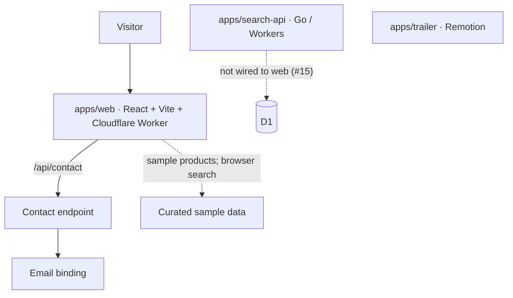
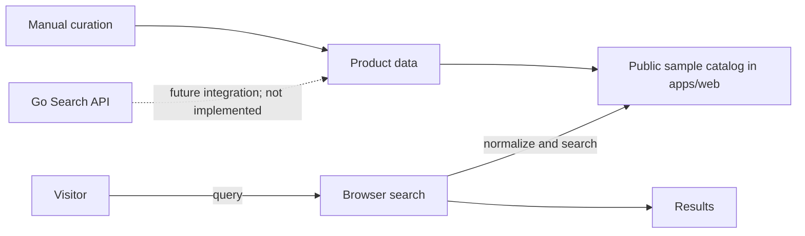

# TaiwanHaul

A curated guide to Taiwanese products for Visitors in Southeast Asia. Product data is hand-curated; the site does not collect prices from marketplaces.

## Architecture

## Search data flow

## Monorepo

- `apps/web` — deployed website and contact Worker.
- `apps/search-api` — Go Workers proof of concept; not connected to the web app.
- `apps/trailer` — standalone Remotion trailer.
- `docs/` — architecture, product rules, and infrastructure notes.

Install with `bun install`. Run `bun run test`, `bun run typecheck`, or `bun run build` from the repository root. See [docs](docs/README.md) for detailed project notes.
