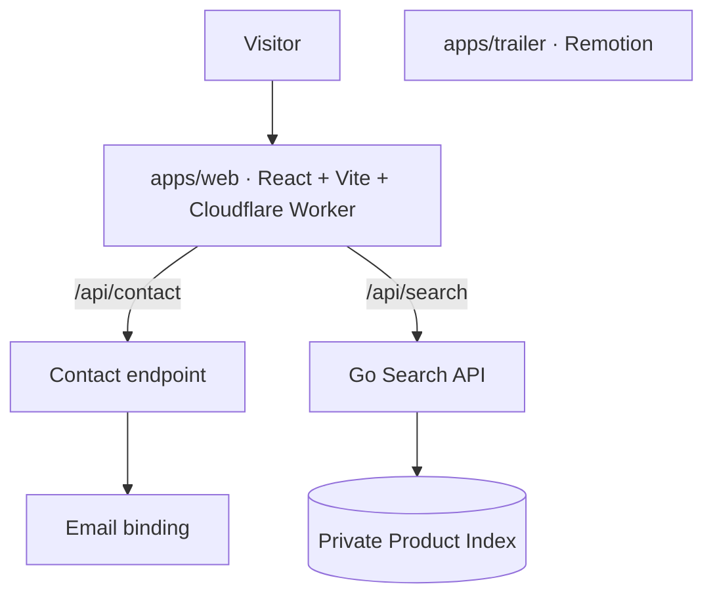
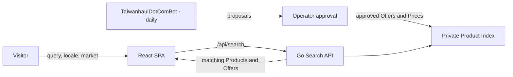

# TaiwanHaul

A curated guide to Taiwanese products for Visitors in Southeast Asia. A daily bot (`TaiwanhaulDotComBot`) reads eligible brands' own official shops and a person approves every new product and price change; the site does not collect from marketplaces. See [ADR 0004](docs/adr/0004-daily-collection-from-brand-shops.md).

## Architecture

## Search data flow

## Monorepo

- `apps/web` — deployed website and contact Worker.
- `apps/search-api` — Go Workers API called by the web search UI.
- `apps/trailer` — standalone Remotion trailer.
- `docs/` — architecture, product rules, and infrastructure notes.

Install with `bun install`. Run `bun run test`, `bun run typecheck`, or `bun run build` from the repository root. See [docs](docs/README.md) for detailed project notes.
