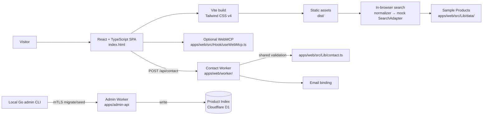
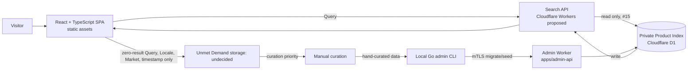

# TaiwanHaul Architecture Notes

Related documents: [Product Spec](product-spec.md), [Glossary](../CONTEXT.md), [ADR 0001 — Search Reads a Prebuilt Index](adr/0001-search-reads-prebuilt-index.md), and [ADR 0002 — SPA Without SSR](adr/0002-spa-without-ssr.md).

## Current Architecture

The web app is a Vite-built React 19 + TypeScript SPA in `apps/web`. `apps/web/index.html` mounts the app; Vite builds the client and static `privacy.html` entry into `apps/web/dist/`. Tailwind CSS v4 is compiled by `@tailwindcss/vite`; the Cloudflare Vite plugin runs the Worker locally. Workers serves the built assets; `apps/web/wrangler.json` routes `/api/*` through the Worker and uses SPA fallback elsewhere.

### Layout and URL parameters

The web app lives in `apps/web`: `index.html`, `privacy.html`, `src/` (React app), `worker/` (contact API), `public/` (static assets), and `tests/`. `apps/search-api/` contains the Go proof of concept; `apps/trailer/` contains the separate Remotion project. `dist/` is generated output. The web app's `wrangler.json` configures the Worker and assets.

Visitors can set `?lang=en|zh-TW|th|vi|ms|fil`, `?market=SG|MY|TH|VN|PH`, and `?q=pineapple%20cake`.

### Localization

Supported locales are English, Traditional Chinese, Thai, Vietnamese, Malay, and Filipino; Singapore uses English or Chinese, and `tl` maps to Filipino. Locale and Market resolution prefer URL parameters, then saved choices in `localStorage`, then browser languages/region hints, then defaults (`en` and the inferred/default market). React messages use `t()`; localized data uses `pick()`. To add a locale, add `apps/web/src/Lib/data/locales/<code>.ts`, register it in `LOCALES` in `apps/web/src/Lib/i18n.ts`, and add translations/data as needed. Tests check message keys and localized data. Thai, Vietnamese, Malay, and Filipino copy is first-pass and needs native-speaker review before launch.

### Search boundary

Search runs in the browser and uses public sample Products, not a live Product Index:

```text
search(query, { locale, market }) → normalizeQuery() → mock SearchAdapter.search() → NormalizedResult[]
```

The normalizer handles dictionary terms and passthroughs. If an adapter fails, other results are still returned; searches can be aborted. The homepage now has one Discovery section and no price comparisons. There is no server-side storage, so Unmet Demand is not recorded. Query appears in the browser URL (`?q=`).

### Product Index writes

The local Go admin CLI sends migrations and curated seed data to `apps/admin-api` over mTLS. The Admin Worker validates and writes to D1. This is a write-only path: the web Worker has no D1 binding, and Visitor search does not read the index yet. Search reads arrive with #15.

### Analytics and WebMCP

`track(name, props)` in `apps/web/src/Lib/analytics.ts` calls registered sinks and dispatches `taiwanhaul:track`; no vendor is wired. Events contain coarse properties, never raw search text or contact-form content.

Where `navigator.modelContext` is available, `apps/web/src/Hook/useWebMcp.ts` registers `search_taiwan_products`, `list_featured_products`, `set_preferences`, and `open_contact_form`. These tools reuse UI behavior and never submit on a visitor's behalf. Unsupported browsers are unaffected; `apps/web/public/llms.txt` describes the tools.

### Contact form backend

The Contact CTA opens a native `<dialog>` and POSTs JSON to `POST /api/contact`. `apps/web/worker/index.js`, `apps/web/worker/router.js`, and `apps/web/worker/handle-contact.js` handle the route; the Worker and client share `validateContact()` from `apps/web/src/Lib/contact.ts`. A honeypot field is also used.

1. **Origin:** accept `https://taiwanhaul.com`, `https://www.taiwanhaul.com`, their HTTP variants, `https://*.workers.dev`, and HTTP localhost/127.0.0.1 on any port. A missing or other Origin returns `400 {"error":"server"}`.
2. **Request shape:** non-JSON content type returns `415`; a body over 10 KB returns `413`; malformed JSON returns `400` with empty `fields`.
3. **Validation:** shared validation failures return `400 {"ok":false,"error":"validation","fields":{...}}` using the same field codes as the client.
4. **Honeypot:** a filled `website` field returns `200 {"ok":true}` without Turnstile verification or email.
5. **Turnstile:** verify `turnstileToken` server-side through `siteverify` using `TURNSTILE_SECRET`. The endpoint fails closed: verification failure returns `403 {"error":"captcha"}`; missing secret or a broken `siteverify` call returns `500 {"error":"server"}`. No email is sent.
6. **Email:** on success, build an RFC 5322 message with CRLF headers, a base64 `text/plain` body, and an RFC 2047 encoded Subject; send through the `SEND_EMAIL` binding. `From` is `CONTACT_FROM`, `To` is the `CONTACT_TO` secret, and `Reply-To` is the visitor's email. Check header values for CR/LF to prevent header injection. `CONTACT_TO` is never in the repo; the destination address exists only as a Worker secret.

### Country flags

Language and country selectors use emoji flags. Windows may show 🇸🇬 as `SG`; `apps/web/src/Lib/flags.ts` detects that case and registers a self-hosted flag-only font (`apps/web/public/assets/fonts/TwemojiCountryFlags.woff2`, about 78 KB). `unicode-range` limits it to flags, and platforms with native flags do not download it. The detection logic is adapted from [country-flag-emoji-polyfill](https://github.com/talkjs/country-flag-emoji-polyfill) (MIT). The artwork is Twemoji, CC-BY 4.0; attribution is in `apps/web/public/assets/fonts/LICENSE-TwemojiCountryFlags.md`.

Tests are in `apps/web/tests/*.test.js` and run with Bun. GitHub Actions installs with `bun install --frozen-lockfile` and runs workspace scripts before deployment.



The Admin Worker provides the Product Index write path; Product Merge, grouped Merchant Offers, Unmet Demand storage, and Search API/Visitor reads are not connected yet.

## Target Architecture (Proposed)

Search should read a pre-built private Product Index through a Search API; it does not start live collection from external sites. Product data is hand-curated because automated collection from Platforms is prohibited by their terms. Cloudflare D1 is the index store, with writes through the Admin Worker; Search API reads arrive with #15. Unmet Demand may inform future curation priority; its storage and prioritization details remain open.



The index contains hand-curated Products and Offers, not a full public dataset. Search responses are limited to the results needed by the SPA; a private index does not prevent public API responses from being collected by others.


## Decisions

| Decision | Status | Notes |
|---|---|---|
| Use Bun for package management and tests, Vite for the React + TypeScript SPA, and Tailwind CSS v4 as a package. | Confirmed (2026-10-29) | Build uses `@cloudflare/vite-plugin` and outputs to `dist/`. |
| No SSR; deploy a React + TypeScript SPA as static assets with Workers. | Confirmed | See [ADR 0002](adr/0002-spa-without-ssr.md). |
| Search reads a pre-built private Product Index; a Visitor search never triggers live external-site collection. | Confirmed | See [ADR 0001](adr/0001-search-reads-prebuilt-index.md). |
| Keep Product Index collection and Visitor search as separate workflows. | Confirmed | Product curation is separate from visitor search. |
| Product data is hand-curated; automated collection from Platforms is prohibited by their terms. | Confirmed (2026-10-29) | Current search uses public sample Products. |
| Prefer Python for product cleanup and ETL if future permitted workflows require it. | Confirmed | Language preference, not a decision about where a job runs. |
| Use TanStack Router, Query, and/or Form where useful. | Proposed | Adopt each only if the application needs it. |
| Use Cloudflare D1 for the private Product Index. | Confirmed (2026-10-30) | Separate staging and production databases; the Admin Worker handles writes. Search reads arrive with #15. |
| Run a Search API on Cloudflare Workers. | Proposed | API architecture is proposed; deployment implementation remains undecided. |
| Implement the Search API in Go (`syumai/workers-go`) or TypeScript/Hono. | Undecided | Go PoC: Go 1.27.3 with workers-go v0.36.0; WASM 7,722,513 bytes raw and 2,116,099 bytes gzip (`gzip -9`), below the 3 MiB free compressed limit. Local Miniflare warm requests were 5–7 ms; first local request was 50 ms. Production cold start was not measured. |
| Use Terraform for infrastructure. | Deferred | Revisit after the Go Search API experiment. |
| Run future permitted data work locally on a schedule, in GitHub Actions, or another on-demand environment. | Undecided | No always-on service is required by the current decision. |
| Use zero-result Unmet Demand to inform Product Index update priority. | Proposed | Storage location and operational policy are open. |

The related Product Spec is the source for product behavior and scope; the ADRs capture the accepted architecture decisions. Proposed items are not commitments to implement them as written.

## Open Decisions

- **Search API implementation:** Go with `syumai/workers-go`, or TypeScript/Hono? The Go PoC has a compressed WASM size of 2,116,099 bytes, local warm latency of 5–7 ms and first local latency of 50 ms; production cold start was not measured, so the choice remains open.
- **TanStack packages:** Which of Router, Query, and Form are justified by actual SPA needs?
- **Product Index storage:** Cloudflare D1 is proposed, not validated.
- **Unmet Demand storage:** Where should zero-result Query, Locale, Market, and timestamp be stored? Retention is decided: raw Queries 90 days, then aggregate counts only. No storage exists yet. This is the sole documented exception to the current rule against sending raw search text to analytics. A privacy notice must be published before recording starts (see [privacy research](research/privacy-notice.md)).


## Terminology

In the current code, a `SearchAdapter` is a browser-time query adapter: its `search(query, ctx, opts)` method returns normalized results (`apps/web/src/Lib/search/type.ts`). In the target collection pipeline, an Adapter would be a separate component; however, automated collection from Platforms is prohibited by their terms, and product data is hand-curated.

The current runtime `NormalizedResult` has a single price and source adapter ID. Its contract does not represent the separate `Merchant`, `Platform`, and `Variant` fields or checked date needed for an `Offer` and `Fresh Price` behavior.

Use the capitalized terms in [CONTEXT.md](../CONTEXT.md): Product, Variant, Platform, Merchant, Offer, Product Index, Product Merge, Price, Fresh Price, Local Estimate, Query, Chinese Search Term, Best Match, External Search Link, Outbound Link, Unmet Demand, Discovery Content, Delivery Inquiry, Locale, Market, and Visitor.

## Data Privacy

- The full Product Index must remain private and must not be published as a complete dataset.
- Existing public mock Products and illustrative sample data may remain public; they are not the private Product Index.
- Public Search API responses can still be scraped. Private storage alone does not prevent collection of data exposed by the API.
- Current analytics explicitly avoids raw search text. The proposed Unmet Demand record is the narrow exception: store only raw Query, Locale, Market, and timestamp for zero-result searches; no IP address or identifying data; scrub emails and phone numbers; fixed retention.
- The Contact form and Turnstile process personal data; Workers observability logs are enabled (`apps/web/wrangler.json`). The privacy notice is at [`privacy.html`](../apps/web/privacy.html).

## Constraints / Risks

- Automated collection from Platforms is prohibited by their terms; product data is hand-curated.
- A private database does not prevent collection of Product data returned by a public API.
- Go on Cloudflare Workers has not been evaluated in production; the PoC's production cold start was not measured.
- The Product Index cannot guarantee coverage of every Taiwanese e-commerce Product.

## Future Experiments

The Go Search API proof of concept lives in [`apps/search-api/`](../apps/search-api/). Its OpenAPI 3.1 contract is [`packages/shared/openapi.yaml`](../packages/shared/openapi.yaml); `bun run gen` regenerates the Go types/server interface and TypeScript types. The API is not wired to the web app (#15); its implementation and Product Index storage remain open.

### Adapter Authoring — Exploratory

Do not build an automated Platform collection workflow: automated collection is prohibited by Platform terms. Product data is hand-curated.

## Future work

- Real query translation and a Search API over the private Product Index.
- Real pricing/FX source for Local Estimates; price comparison itself is deferred (see [Product Spec](product-spec.md)).
- Analytics sink (GA and/or a Grafana-backed collector).
- Prerendered/locale-prefixed pages (`/zh-tw/`) for performance and SEO.
- Real product imagery and a maintainer avatar in the footer.
