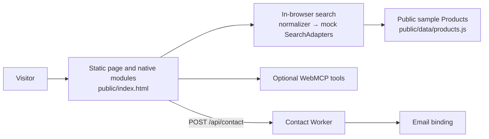
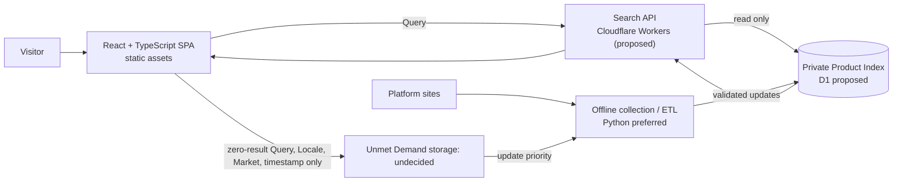

# TaiwanHaul Architecture Notes

Related documents: [Product Spec](product-spec.md), [Glossary](../CONTEXT.md), [ADR 0001 — Search Reads a Prebuilt Index](adr/0001-search-reads-prebuilt-index.md), and [ADR 0002 — SPA Without SSR](adr/0002-spa-without-ssr.md).

## Current Architecture

The deployed site is static assets served from `public/` by Cloudflare Workers Static Assets. There is no application build step: the page loads native ES modules and Tailwind Play CDN (`wrangler.json`, `public/index.html`).

Search currently runs entirely in the Visitor's browser. `public/js/search/index.js` normalizes a Query and calls two mock SearchAdapters in parallel; `public/js/search/normalize.js` uses a dictionary, Chinese passthrough, or folded-query passthrough. The adapters in `public/js/search/adapters/mock.js` read the public sample Products in `public/data/products.js`. Results are mock data, not real product search (`isMock` is true). `public/js/search/types.js` defines the current JSDoc contract.

The Worker's only application route is `POST /api/contact` (`worker/index.js`, `worker/router.js`, `worker/handle-contact.js`). Other requests are served as static assets (`wrangler.json`). WebMCP optionally exposes the in-page search, featured sections, preferences, and Contact tools (`public/js/webmcp.js`, wired in `public/js/app.js`); it is progressive enhancement and does nothing where the browser API is unavailable.

Analytics events are emitted locally by `track()` to registered sinks and a browser event (`public/js/analytics.js`). No sink is wired in the repository, and callers are instructed to send coarse properties, not raw Query text. Tests use Node's built-in test runner (`tests/*.test.js`, `package.json`); GitHub Actions runs them on Node 22 (`.github/workflows/test.yml`). Separate workflows deploy on pushes to `main` and upload preview versions for pull requests (`.github/workflows/deploy.yml`, `.github/workflows/preview.yml`).



Current gaps: the Product Index is not private today because the mock sample Products are public. Current search does not perform Product Merge or group Merchant Offers. The existing homepage's “Cheaper in Taiwan” section shows illustrative price comparisons; the Product Spec drops its Prices and merges it into Discovery Content. There is no server-side storage, so Unmet Demand is not recorded. The Query only appears in the browser URL (`?q=`, `public/js/app.js` `updateUrl`) and therefore in browser history and any request log that sees a reloaded URL.

## Target Architecture (Proposed)

Search should read a pre-built private Product Index. A Visitor search calls a Search API; it does not start live collection from external sites. Collection and ETL are separate, offline/on-demand work, with Python as the preferred language. Collection writes validated results into the private Product Index. Unmet Demand may inform what to update next; its storage and prioritization details remain open.



The index contains curated Products and Offers, not a public full-dataset export. Search responses are limited to the results needed by the SPA; a private index does not prevent public API responses from being collected by others.

## Decisions

| Decision | Status | Notes |
|---|---|---|
| Migrate the frontend toward React + TypeScript + TanStack; do not use Next.js. | Confirmed | No SSR; keep the deployment serverless-oriented with static assets and Workers. Revisit only if an SEO evaluation shows build-time prerendering is not enough. See [ADR 0002](adr/0002-spa-without-ssr.md). |
| Search reads a pre-built private Product Index; a Visitor search never triggers live external-site crawling. | Confirmed | See [ADR 0001](adr/0001-search-reads-prebuilt-index.md). |
| Keep Product Index collection and Visitor search as separate workflows. | Confirmed | Product data and curation are private data assets, not a full public repository dataset. |
| Prefer Python for product collection, cleanup, and ETL. | Confirmed | Language preference, not a decision about where the job runs. |
| Prefer reusable Platform search and parsing Adapters / Templates. | Confirmed | Refers to collection-time Python Adapters, not the current browser SearchAdapter; see Terminology. |
| Do not require an LLM call for every normal data update. | Confirmed | Normal execution uses previously validated code. |
| No always-on crawler service is currently needed. | Confirmed | Collection may be run on demand or on a schedule; runtime is undecided. |
| Use TanStack Router, Query, and/or Form where useful. | Proposed | Adopt each only if the application needs it. |
| Use Cloudflare D1 for the private Product Index. | Proposed | Not selected or validated. |
| Run a Search API on Cloudflare Workers. | Proposed | API architecture is proposed; deployment implementation remains undecided. |
| Implement the Search API in Go (`syumai/workers-go`) or TypeScript/Hono. | Undecided | Compare and validate before choosing. |
| Run Python collection locally on a schedule, in GitHub Actions, or another on-demand environment. | Undecided | No always-on service is required by the current decision. |
| Limit each source to at most one controlled update run per day. | Proposed | Actual frequency and request budget must respect each source's limits. |
| Use zero-result Unmet Demand to inform Product Index update priority. | Proposed | Storage location and operational policy are open. |

The related Product Spec is the source for product behavior and scope; the ADRs capture only the two accepted architecture decisions above. Proposed items are not commitments to implement them as written.

## Open Decisions

- **Search API implementation:** Go with `syumai/workers-go`, or TypeScript/Hono? Go on Workers needs a proof of concept before selection.
- **TanStack packages:** Which of Router, Query, and Form are justified by actual SPA needs?
- **Product Index storage:** Cloudflare D1 is proposed, not validated.
- **Collection runtime:** Local scheduling, GitHub Actions, or another on-demand environment?
- **Update cadence and budget:** How often should each source be checked, up to the proposed ceiling of one controlled run per source per day, and within what request budget?
- **Unmet Demand storage:** Where should zero-result Query, Locale, Market, and timestamp be stored? Retention is decided: raw Queries 90 days, then aggregate counts only. No storage exists yet. This is the sole documented exception to the current rule against sending raw search text to analytics. A privacy notice must be published before recording starts (none exists today; see [privacy research](research/privacy-notice.md)).
- **Structured data per Platform:** Which Platforms can provide structured Product data within their terms and limits? This decides what can enter the Product Index. It no longer decides External Search Links, which only need a working public search URL (see Product Spec rule 8).

## Terminology

In the current code, a `SearchAdapter` is a browser-time query adapter: its `search(query, ctx, opts)` method returns normalized results (`public/js/search/types.js`). In the target collection pipeline, an Adapter is a Python component that searches a Platform and parses collected product data. These are different roles; do not treat the current interface as the target collection Adapter contract.

The current runtime `NormalizedResult` has a single price and source adapter ID. Its contract lacks the separate `Merchant`, `Platform`, and `Variant` fields and the checked date needed to represent an `Offer` and enforce `Fresh Price` behavior. `source` is only described as the adapter ID, not a Merchant or Platform identity (`public/js/search/types.js`).

Use the capitalized terms in [CONTEXT.md](../CONTEXT.md): Product, Variant, Platform, Merchant, Offer, Product Index, Product Merge, Price, Fresh Price, Local Estimate, Query, Chinese Search Term, Best Match, External Search Link, Outbound Link, Unmet Demand, Discovery Content, Delivery Inquiry, Locale, Market, and Visitor.

## Data Privacy

- The full Product Index must remain private and must not be published as a complete dataset.
- Existing public mock Products and illustrative sample data may remain public; they are not the private Product Index.
- Public Search API responses can still be scraped. Private storage alone does not prevent collection of data exposed by the API.
- Current analytics explicitly avoids raw search text. The proposed Unmet Demand record is the narrow exception: store only raw Query, Locale, Market, and timestamp for zero-result searches; no IP address or identifying data; scrub emails and phone numbers; fixed retention.
- The site has no privacy notice, although the Contact form and Turnstile already process personal data and Workers observability logs are enabled (`wrangler.json`). Publishing one is a launch requirement in the Product Spec.

## Constraints / Risks

- Do not assume Shopee, momo, or PChome provide a public whole-site product search API.
- Collection must respect each Platform's terms, robots rules, authorization, rate limits, and access controls. A daily update does not permit unrestricted collection.
- A private database does not prevent collection of Product data returned by a public API.
- Go on Cloudflare Workers requires a proof of concept for Wasm, D1, bundle size, latency, and deployment limits.
- Availability of external Product data and the legal right to display it again are major product risks.
- The Product Index cannot guarantee coverage of every Taiwanese e-commerce Product.

## Future Experiments

### Adapter Authoring — Exploratory

A PickleScout-style authoring flow is an experiment, not an MVP prerequisite:

```text
Agent explores a Platform
  → ActionLog
  → Gherkin specification
  → reusable Python collection Adapter
  → automated validation
  → scheduled execution
```

The intent is for an agent to help explore a Platform and produce a reusable, testable search-and-parsing Adapter. Gherkin describes expected behavior. Normal runs use reviewed, validated code rather than calling an LLM each time; tests can flag Platform changes for human review. Whether the engine, Adapter Template, or Product data should be open source is undecided.
