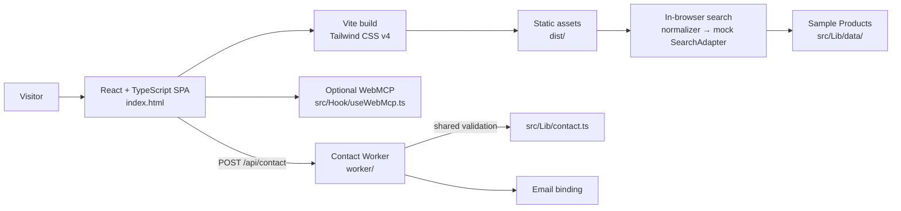
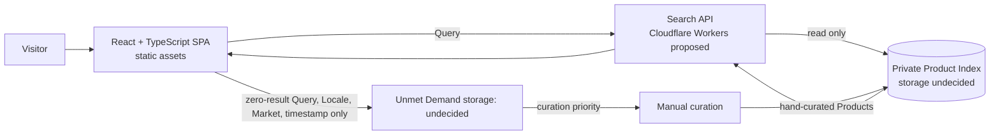

# TaiwanHaul Architecture Notes

Related documents: [Product Spec](product-spec.md), [Glossary](../CONTEXT.md), [ADR 0001 — Search Reads a Prebuilt Index](adr/0001-search-reads-prebuilt-index.md), and [ADR 0002 — SPA Without SSR](adr/0002-spa-without-ssr.md).

## Current Architecture

The application is a Vite-built React 19 + TypeScript SPA. `index.html` mounts the React app; Vite builds the client and static `privacy.html` entry into `dist/`. Tailwind CSS v4 is installed as a package and compiled by `@tailwindcss/vite`. The Cloudflare Vite plugin runs the Worker locally. Cloudflare Workers serves the built assets; `wrangler.json` routes `/api/*` through the Worker and uses SPA fallback for other paths.

Search runs in the visitor's browser. `src/Lib/search/index.ts` normalizes a Query and calls the mock SearchAdapter in `src/Lib/search/adapters/mock.ts`; sample Products live under `src/Lib/data/`. Search data is mock data, not a live product index. Search types are in `src/Lib/search/type.ts`.

The Worker's application route is `POST /api/contact` (`worker/index.js`, `worker/router.js`, `worker/handle-contact.js`). Contact validation is shared from `src/Lib/contact.ts`. WebMCP optionally exposes search, featured content, preferences, and Contact tools through `src/Hook/useWebMcp.ts`; it is progressive enhancement and does nothing where the browser API is unavailable.

Analytics events are emitted locally by `track()` to registered sinks and a browser event (`src/Lib/analytics.ts`). No sink is wired in the repository, and event properties exclude raw Query text. Tests are in `tests/*.test.js` and run with Bun; GitHub Actions installs with `bun install --frozen-lockfile` and builds with `bun run build` before deployment.

Current gaps: search uses public sample Products, not a private Product Index. Current search does not perform Product Merge or group Merchant Offers. The homepage's “Cheaper in Taiwan” section shows illustrative price comparisons; the Product Spec drops its Prices and merges it into Discovery Content. There is no server-side storage, so Unmet Demand is not recorded. Query only appears in the browser URL (`?q=`).

## Target Architecture (Proposed)

Search should read a pre-built private Product Index. A Visitor search calls a Search API; it does not start live collection from external sites. Product data is hand-curated because automated collection from Platforms is prohibited by their terms. The Search API implementation and Index storage remain undecided. Unmet Demand may inform future curation priority; its storage and prioritization details remain open.

The index contains hand-curated Products and Offers, not a full public dataset. Search responses are limited to the results needed by the SPA; a private index does not prevent public API responses from being collected by others.

## Decisions

| Decision | Status | Notes |
|---|---|---|
| Use Bun for package management and tests, Vite for the React + TypeScript SPA, and Tailwind CSS v4 as a package. | Confirmed (2026-10-29) | Build uses `@cloudflare/vite-plugin` and outputs to `dist/`. |
| No SSR; deploy a React + TypeScript SPA as static assets with Workers. | Confirmed | See [ADR 0002](adr/0002-spa-without-ssr.md). |
| Search reads a pre-built private Product Index; a Visitor search never triggers live external-site collection. | Confirmed | See [ADR 0001](adr/0001-search-reads-prebuilt-index.md). |
| Keep Product Index collection and Visitor search as separate workflows. | Confirmed | Product curation is separate from visitor search. |
| Product data is hand-curated; automated collection from Platforms is prohibited by their terms. | Confirmed (2026-10-29) | Prices are shown but are not attributed to any Platform. |
| Prefer Python for product cleanup and ETL if future permitted workflows require it. | Confirmed | Language preference, not a decision about where a job runs. |
| Use TanStack Router, Query, and/or Form where useful. | Proposed | Adopt each only if the application needs it. |
| Use Cloudflare D1 for the private Product Index. | Proposed | Not selected or validated. |
| Run a Search API on Cloudflare Workers. | Proposed | API architecture is proposed; deployment implementation remains undecided. |
| Implement the Search API in Go (`syumai/workers-go`) or TypeScript/Hono. | Undecided | Go PoC: Go 1.27.3 with workers-go v0.36.0; WASM 7,722,513 bytes raw and 2,116,099 bytes gzip (`gzip -9`), below the 3 MiB free compressed limit. Local Miniflare warm requests were 5–7 ms; first local request was 50 ms. Production cold start was not measured. |
| Use Terraform for infrastructure. | Deferred | Revisit after the Go Search API experiment. |
| Run future permitted data work locally on a schedule, in GitHub Actions, or another on-demand environment. | Undecided | No always-on service is required by the current decision. |
| Use zero-result Unmet Demand to inform Product Index update priority. | Proposed | Storage location and operational policy are open. |

The related Product Spec is the source for product behavior and scope; the ADRs capture the accepted architecture decisions. Proposed items are not commitments to implement them as written.

## Open Decisions

- **Search API implementation:** Go with `syumai/workers-go`, or TypeScript/Hono? The Go PoC has a compressed WASM size of 2,116,099 bytes, local warm latency of 5–7 ms and first local latency of 50 ms; production cold start was not measured, so the choice remains open.
- **TanStack packages:** Which of Router, Query, and Form are justified by actual SPA needs?
- **Product Index storage:** Cloudflare D1 is proposed, not validated.
- **Unmet Demand storage:** Where should zero-result Query, Locale, Market, and timestamp be stored? Retention is decided: raw Queries 90 days, then aggregate counts only. No storage exists yet. This is the sole documented exception to the current rule against sending raw search text to analytics. A privacy notice must be published before recording starts (see [privacy research](research/privacy-notice.md)).

## Terminology

In the current code, a `SearchAdapter` is a browser-time query adapter: its `search(query, ctx, opts)` method returns normalized results (`src/Lib/search/type.ts`). In the target collection pipeline, an Adapter would be a separate component; however, automated collection from Platforms is prohibited by their terms, and product data is hand-curated.

The current runtime `NormalizedResult` has a single price and source adapter ID. Its contract does not represent the separate `Merchant`, `Platform`, and `Variant` fields or checked date needed for an `Offer` and `Fresh Price` behavior.

Use the capitalized terms in [CONTEXT.md](../CONTEXT.md): Product, Variant, Platform, Merchant, Offer, Product Index, Product Merge, Price, Fresh Price, Local Estimate, Query, Chinese Search Term, Best Match, External Search Link, Outbound Link, Unmet Demand, Discovery Content, Delivery Inquiry, Locale, Market, and Visitor.

## Data Privacy

- The full Product Index must remain private and must not be published as a complete dataset.
- Existing public mock Products and illustrative sample data may remain public; they are not the private Product Index.
- Public Search API responses can still be scraped. Private storage alone does not prevent collection of data exposed by the API.
- Current analytics explicitly avoids raw search text. The proposed Unmet Demand record is the narrow exception: store only raw Query, Locale, Market, and timestamp for zero-result searches; no IP address or identifying data; scrub emails and phone numbers; fixed retention.
- The Contact form and Turnstile process personal data; Workers observability logs are enabled (`wrangler.json`). The privacy notice is at [`privacy.html`](../privacy.html).

## Constraints / Risks

- Automated collection from Platforms is prohibited by their terms; product data is hand-curated.
- A private database does not prevent collection of Product data returned by a public API.
- Go on Cloudflare Workers has not been evaluated in production; the PoC's production cold start was not measured.
- The Product Index cannot guarantee coverage of every Taiwanese e-commerce Product.

## Future Experiments

The Go Search API proof of concept lives in [`experiments/workers-go-search/`](../experiments/workers-go-search/). It exercises local Wrangler and D1 only; the implementation choice remains open.

### Adapter Authoring — Exploratory

Do not build an automated Platform collection workflow: automated collection is prohibited by Platform terms. Product data is hand-curated.
